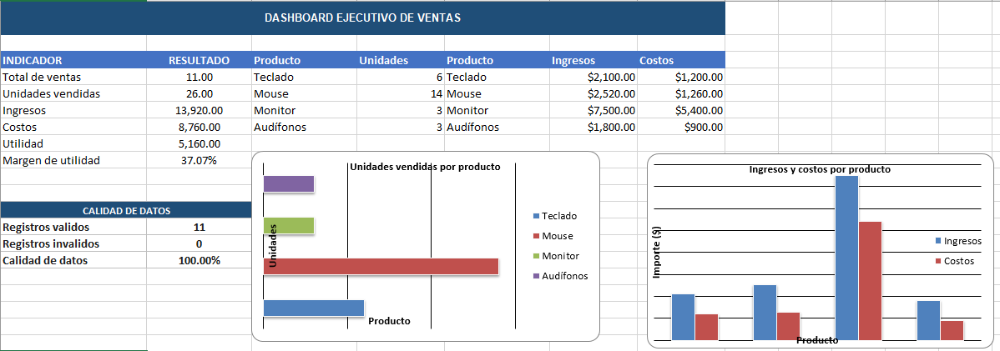
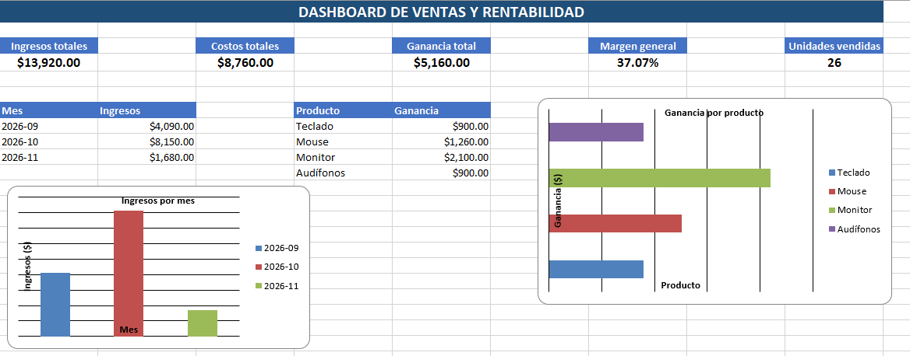

# Proyecto de Analisis de Ventas

## Descripcion

Este proyecto consiste en desarrollar un sistema de analisis de ventas utilizando Python y Excel.

El objetivo es procesar informacion de ventas, calcular indicadores financieros, analizar la rentabilidad de los productos y generar reportes automaticos que faciliten la toma de decisiones.

El proyecto incluye herramientas para validar la calidad de los datos, generar dashboards ejecutivos y crear respaldos automaticos de los reportes..


## Objetivos del Proyecto

- Analizar la informacion de ventas.
- Calcular ingresos, costos, utilidad y margen de rentabilidad.
- Identificar los productos con mayor volumen de ventas.
- Generar reportes automaticos en Excel.
- Crear dashboards para visualizar los resultados.
- Validar la calidad de la informacion.
- Automatizar la ejecucion de los reportes.
- Mantener respaldos historicos de los archivos generados.


## Herramientas y Tecnologias

- **Python:** lenguaje de programacion utilizado para procesar y analizar los datos.
- **openpyxl:** biblioteca para leer, crear y modificar archivos de Excel.
- **Excel:** herramienta para almacenar datos y presentar los reportes.
- **Visual Studio Code:** entorno de desarrollo utilizado para escribir y ejecutar los programas.
- **SQLite:** base de datos utilizada durante el aprendizaje de consultas y almacenamiento de informacion.
- **PowerShell:** terminal utilizada para ejecutar los programas de Python.


## Estructura del Proyecto

```text
Proyecto_Final/
│
├── datos/
│   ├── ventas.xlsx
│   └── costos_productos.xlsx
│
├── reportes/
│   ├── reporte_ventas.xlsx
│   ├── reporte_rentabilidad.xlsx
│   ├── dashboard_ventas.xlsx
│   ├── dashboard_ejecutivo.xlsx
│   ├── reporte_calidad_datos.xlsx
│   ├── reporte_calidad_avanzado.xlsx
│   ├── reporte_general.xlsx
│   ├── historial_por_fecha.xlsx
│   └── ejecuciones.log
│
├── scripts/
│   ├── 15_automatizar_proyecto.py
│   ├── 23_crear_respaldo_reportes.py
│   ├── 28_reporte_general.py
│   └── 29_dashboard_ejecutivo.py
│
└── README.md
```

## Reportes Generados

El proyecto genera automaticamente los siguientes reportes:

| Archivo | Descripcion |
|---|---|
| reporte_ventas.xlsx | Resumen general de las ventas. |
| reporte_rentabilidad.xlsx | Analisis de ingresos, costos y utilidad. |
| dashboard_ventas.xlsx | Visualizacion de indicadores de ventas. |
| dashboard_ejecutivo.xlsx | Dashboard con indicadores y graficos ejecutivos. |
| reporte_calidad_datos.xlsx | Validacion de los registros de ventas. |
| reporte_calidad_avanzado.xlsx | Analisis avanzado de calidad de datos. |
| reporte_general.xlsx | Resumen general de los indicadores del proyecto. |
| historial_por_fecha.xlsx | Historial de ejecuciones por fecha. |
## Vista Previa de los Dashboards

### Dashboard Ejecutivo



### Dashboard de Ventas



Adicionalmente, el sistema registra las ejecuciones en un archivo de log y genera respaldos automaticos de los reportes.

## Resultados del Analisis

Los resultados obtenidos con los datos actuales del proyecto son:

| Indicador | Resultado |
|---|---:|
| Total de ventas | 11 |
| Unidades vendidas | 26 |
| Ingresos totales | $13,920.00 |
| Costos totales | $8,760.00 |
| Utilidad total | $5,160.00 |
| Margen de utilidad | 37.07% |
| Registros validos | 11 |
| Registros invalidos | 0 |
| Calidad de datos | 100% |

### Hallazgos principales

- El proyecto registra 26 unidades vendidas en 11 operaciones.
- Los ingresos totales ascienden a $13,920.00.
- La utilidad obtenida es de $5,160.00.
- El margen de utilidad general es de 37.07%.
- Los 11 registros analizados cumplen las validaciones actuales de calidad.

## Como Ejecutar el Proyecto

### 1. Requisitos

- Tener Python instalado.
- Tener Visual Studio Code o una terminal.
- Instalar la biblioteca openpyxl.

### 2. Instalar la biblioteca

```powershell
pip install openpyxl
```

### 3. Ejecutar el proyecto

Desde la carpeta Proyecto_Final, ejecutar el siguiente comando:

```powershell
python scripts/15_automatizar_proyecto.py
```

### 4. Resultados

El programa ejecutara automaticamente los scripts del proyecto y generara los reportes de Excel.

Los archivos generados se guardaran en la carpeta reportes.

Tambien se registraran las ejecuciones y se crearan respaldos automaticos.

## Validacion y Calidad de los Datos

El proyecto incluye herramientas para revisar la calidad de la informacion antes de generar los reportes.

Entre las validaciones realizadas se encuentran:

- Identificar registros incompletos.
- Detectar cantidades y precios invalidos.
- Revisar productos que no existen en el catalogo.
- Identificar registros duplicados.
- Calcular el porcentaje de registros validos.

En la ultima revision se obtuvieron los siguientes resultados:

| Indicador | Resultado |
|---|---:|
| Registros revisados | 11 |
| Registros validos | 11 |
| Registros invalidos | 0 |
| Calidad de los datos | 100% |


## Automatizacion y Respaldos

El proyecto cuenta con un proceso de automatizacion que permite ejecutar los diferentes scripts de manera consecutiva.

Durante la ejecucion se realizan las siguientes tareas:

- Validacion de los archivos de entrada.
- Generacion de reportes de ventas y rentabilidad.
- Actualizacion de dashboards.
- Revision de la calidad de los datos.
- Registro de resultados y errores en un archivo de historial.
- Medicion del tiempo de ejecucion.
- Creacion de respaldos automaticos de los reportes.

El sistema conserva hasta 10 respaldos por cada reporte, eliminando los mas antiguos cuando se supera ese limite.

## Conclusiones

Este proyecto permitió desarrollar un sistema de analisis de ventas utilizando Python y Excel.

Durante su desarrollo se aplicaron conocimientos de:

- Programacion con Python.
- Manejo de archivos Excel.
- Limpieza y validacion de datos.
- Analisis de ventas y rentabilidad.
- Generacion de reportes y dashboards.
- Automatizacion de procesos.
- Manejo de errores y registros de ejecucion.
- Creacion y administracion de respaldos.

El resultado es una herramienta que facilita el analisis de informacion comercial y permite generar reportes de manera automatica.

Este proyecto representa una primera experiencia practica en el desarrollo de soluciones de analisis de datos.
